# Hi there, I'm Amir Mohammad Shahsavarani 👋

### Software Engineer | Lead QA Automation Engineer | Senior SDET | Full-Stack .NET Developer

> Quality Engineering leader with **7+ years** turning fragile manual processes into resilient, automated quality gates — bridging development and QA through scalable test architecture and CI/CD.

I'm a **QA Team Lead and Senior SDET** who designs test automation frameworks and embeds them into robust CI/CD pipelines. With a path from **behavioral science → full-stack .NET → quality engineering**, I bring analytical rigor to user-behavior validation, root-cause analysis, and team leadership. I have designed, developed, and tested (manual and automated) order management systems for forex and securities exchange markets, and core trading engines.

🎯 **Career goal:** Drive quality engineering excellence, grow toward a CTO role.
🌍 **Open to relocation:** Europe (Germany / Netherlands), US, Australia, New Zealand.

---

### 🚀 What I Do
- **🏗️ Test Automation Architecture** — Scalable UI/API/E2E frameworks with Playwright, Selenium, Pytest, NUnit, and BDD/Cucumber workflows.
- **🔄 CI/CD & DevOps** — Test execution in Azure DevOps, GitHub Actions, Docker, and Kubernetes.
- **💻 Software Engineering** — Clean, maintainable test code (C#, Python, TypeScript, Go) following SOLID, OOP, and Clean Code.
- **📈 Markets** — Design, development, and manual and automated testing of order management systems for forex and securities exchanges, and of core trading engines: order lifecycle, execution constraints, balances, and the failure modes that matter when money is in motion.
- **🗄️ Data Validation** — Complex database validation across SQL Server (T-SQL) and Oracle (PL/SQL).
- **🤖 AI in QA** — AI-assisted defect triage and log analysis to accelerate investigation.
- **👥 Leadership & Mentorship** — Agile testing strategy, team mentoring, and release-readiness ownership.

---

### 📈 Key Achievements
- ⚡ **Reduced manual regression effort by ≈ 65%** in two months via automation, prioritization, and CI/CD integration.
- 🚀 **Improved engineering delivery speed by ≈ 30%** through workflow and process enhancements (as Sr. Developer).
- 🎓 **ISTQB Foundation Level (CTFL)** certified.

---

### 📌 Featured Projects

**[ForexGuard QA Orchestrator](https://github.com/NPS-Dive/ForexGuard-QA-Orchestrator)**
Public illustration of a forex QA control center: a C# / ASP.NET Core orchestrator driving Playwright (TypeScript), Appium (Python), and k6 suites, with Grafana telemetry for throughput and SLA checks.

**[Gold Trading E2E QA Automation](https://github.com/NPS-Dive/OnlineGoldTradingQAAutomationE2E)**
Public illustration of purchase-flow automation for a gold trading platform (Python, Pytest, Playwright): page objects, deterministic JSON reporting, and checks around balances, receipts, and error states.

**[OmniTest Polyglot Nexus](https://github.com/NPS-Dive/OmniTest-Polyglot-Nexus)**
Public Go example: six gRPC services on one PostgreSQL database, including Go beside C#, Python, Java, TypeScript, and C++, for comparable RAG and QA experiments.

**[BDD E2E Automation — Playwright + TypeScript + Cucumber](https://github.com/NPS-Dive/BDDPlaywrightAutomation)**
End-to-end BDD suite automating a complex, dynamic real-world flow (Booking.com). Demonstrates resilient locator strategies, dynamic-modal handling, custom Cucumber World lifecycle management, cross-browser execution, and automated reporting with failure screenshots.

---

### 🛠️ Tech Stack & Tools

**Languages**  

**QA, Automation & Performance**  

**Backend & Architecture**  

**Databases**  

**DevOps, CI/CD & OS**  

---

### 📊 GitHub Stats

  
  

---

### 📫 Let's Connect
- **LinkedIn:** [Amir Shahsavarani](https://www.linkedin.com/in/amir-shahsavarani)
- **Email:** amirmohammadshi@gmail.com

<em>"Quality is not an act, it is a habit." — Aristotle</em>

